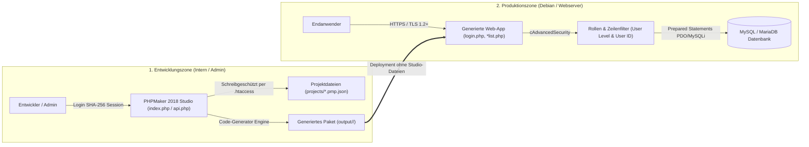

# IT-Sicherheitskonzept: PHPMaker 2018 Studio & Generierte Web-Applikationen

**Dokumentenstatus:** Freigegeben (Version 1.0)  
**Klassifizierung:** Intern / Vertraulich  
**Geltungsbereich:** Entwicklungsumgebung (*PHPMaker 2018 Studio*) sowie alle damit generierten PHP-Zielanwendungen (PHP 5.4 – 8.4+)  
**Referenzstandards:** BSI IT-Grundschutz (APP.3.1 Webanwendungen, CON.8 Software-Entwicklung), ISO/IEC 27001, OWASP Application Security Verification Standard (ASVS) & OWASP Top 10

---

## 1. Management Summary & Zielsetzung

Dieses IT-Sicherheitskonzept beschreibt die technischen und organisatorischen Maßnahmen (TOM), die Sicherheitsarchitektur sowie die Härtungsvorgaben für den Betrieb des **PHPMaker 2018 Studios** und der daraus erzeugten datenbankgestützten Web-Anwendungen.

Das System gliedert sich sicherheitstechnisch in **zwei strikt zu trennende Domänen**:
1. **Entwicklungs- & Generator-Domäne (PHPMaker 2018 Studio):** Werkzeuge zur Datenbank-Inspektion, Projektmodellierung (`.pmp.json`) und Code-Generierung ([`index.php`](file:///c:/Users/uwebe/Documents/Antigravity/phpmakernachbau/index.php), [`api.php`](file:///c:/Users/uwebe/Documents/Antigravity/phpmakernachbau/api.php), [`src/`](file:///c:/Users/uwebe/Documents/Antigravity/phpmakernachbau/src)).
2. **Produktions-Domäne (Generierte Web-Applikation):** Die eigenständige, im Zielverzeichnis (z. B. [`output/crm_shop_demo/`](file:///c:/Users/uwebe/Documents/Antigravity/phpmakernachbau/output/crm_shop_demo)) erzeugte Web-Anwendung für Endbenutzer.



---

## 2. Schutzbedarfsfeststellung (CIA-Triade)

Gemäß BSI-Methodik wird der Schutzbedarf für die Grundwerte **Vertraulichkeit (Confidentiality)**, **Integrität (Integrity)** und **Verfügbarkeit (Availability)** wie folgt eingestuft:

| Schutzobjekt / Komponente | Vertraulichkeit | Integrität | Verfügbarkeit | Begründung |
| :--- | :---: | :---: | :---: | :--- |
| **Projektdateien (`projects/*.pmp.json`)** | **Hoch** | **Hoch** | Normal | Enthalten Datenbank-Zugangsdaten, Tabellenstrukturen und Sicherheitsregeln im Klartext. |
| **Studio-Authentifizierung (`.studio_auth.json`)** | **Hoch** | **Hoch** | Normal | Schützt den Zugang zum Code-Generator und zur Datenbank-Synchronisation. |
| **Benutzertabelle (`benutzer`) & Session-Daten** | **Hoch** | **Hoch** | Hoch | Enthält Authentifizierungsmerkmale, Rollenzuweisungen (`userlevel_id`) und Hierarchien (`vorgesetzter_id`). |
| **Berechtigungstabellen (`userlevels`, `userlevelpermissions`)** | Normal | **Sehr Hoch** | Hoch | Eine Manipulation der Bitmasken würde zu unberechtigter Rechteausweitung (*Privilege Escalation*) führen. |
| **Fachdaten (z. B. `kunden`, `bestellungen`, `produkte`)** | **Hoch** (DSGVO) | **Hoch** | Hoch | Personenbezogene Daten (Kunden/Ansprechpartner) und geschäftskritische Auftragsdaten. |
| **Statische Frontend-Bibliotheken (`assets/vendor/`)** | Niedrig | **Hoch** | Hoch | Lokale Einbindung verhindert Supply-Chain-Angriffe über fremde CDNs und externe Datenabflüsse. |

---

## 3. Sicherheitsarchitektur auf Anwendungsebene (OWASP Top 10 Maßnahmen)

### 3.1 Schutz vor SQL-Injection (OWASP A03: Injection)
- **Prepared Statements als Standard:** Die Datenbank-Abstraktionsschicht [`cEwDbConnection`](file:///c:/Users/uwebe/Documents/Antigravity/phpmakernachbau/output/crm_shop_demo/ewdbhelper14.php) in `ewdbhelper14.php` nutzt für sämtliche Lese-, Such-, Filter- und Schreiboperationen (`INSERT`, `UPDATE`, `DELETE`, `SELECT`, `BuildUserIDFilter`) **parametrisierte Abfragen (`?`-Platzhalter)** über PDO (`$stmt->execute($params)`).
- **Sicherer MySQLi-Fallback:** Falls auf älteren PHP-5.4-Systemen kein PDO verfügbar ist, erfolgt die Parameter-Interpolation zwingend über `$mysqli->real_escape_string()` unter Berücksichtigung des Verbindungzeichensatzes (`set_charset`).
- **Bezeichner-Maskierung (Identifier Quoting):** Alle Tabellen- und Spaltennamen werden in SQL-Abfragen über Backticks (`` `spalte` ``) und Maskierung (`str_replace('`', '``', $col)`) gekapselt.
- **Sortier-Whitelisting:** Die Spaltensortierung (`order` / `dir`) in `*list.php` prüft den übergebenen Feldnamen streng gegen die Whitelist der tatsächlich existierenden Tabellenfelder (`isset($Table->Fields[$orderBy])`) und lässt als Richtung ausschließlich `ASC` oder `DESC` zu.

### 3.2 Schutz vor Cross-Site Scripting – XSS (OWASP A03)
- **Konsequentes Output-Encoding:** Alle Datenbankwerte, URL-Parameter, Suchbegriffe und Benutzernamen werden vor der Ausgabe im HTML-Kontext durch [`ew_HtmlEncode()`](file:///c:/Users/uwebe/Documents/Antigravity/phpmakernachbau/output/crm_shop_demo/phpfn14.php) (`htmlspecialchars($val, ENT_QUOTES, 'UTF-8')`) maskiert.
- **Sichere Tabellen-Generierung in Custom Files:** Auch die Hilfsfunktion `DbHelper()->ExecuteHtml()` maskiert sämtliche Spaltenüberschriften und Zelleninhalte automatisch mit `ENT_QUOTES`.

### 3.3 Schutz vor Cross-Site Request Forgery – CSRF (OWASP A01)
- **Synchronizer Token Pattern:** Jede zustandsverändernde Aktion (`login.php`, `*add.php`, `*edit.php`, `*delete.php`, `*update.php`, `userpriv.php`) erfordert ein kryptografisch zufälliges Session-Token ([`ew_GetCsrfToken()`](file:///c:/Users/uwebe/Documents/Antigravity/phpmakernachbau/output/crm_shop_demo/phpfn14.php) / [`ew_CheckCsrfToken()`](file:///c:/Users/uwebe/Documents/Antigravity/phpmakernachbau/output/crm_shop_demo/phpfn14.php)).
- **Zeitkonstanter Vergleich:** Die Prüfung erfolgt über `hash_equals()` (bzw. einen zeitkonstanten String-Vergleich für PHP < 5.6), um Timing-Seitenkanalangriffe auszuschließen.

### 3.4 Authentifizierung, Rollen & Zeilenbasierte Autorisierung (OWASP A01 & A07)
Das Sicherheitsmodul [`cAdvancedSecurity`](file:///c:/Users/uwebe/Documents/Antigravity/phpmakernachbau/output/crm_shop_demo/phpfn14.php) setzt ein mehrstufiges Zugriffskonzept (**Defense in Depth**) um:

1. **Stufe 1 – Studio-Schutz ([`src/StudioAuth.php`](file:///c:/Users/uwebe/Documents/Antigravity/phpmakernachbau/src/StudioAuth.php)):**
   - Sowohl die Weboberfläche ([`index.php`](file:///c:/Users/uwebe/Documents/Antigravity/phpmakernachbau/index.php)) als auch alle Endpunkte der Generator-API ([`api.php`](file:///c:/Users/uwebe/Documents/Antigravity/phpmakernachbau/api.php)) verweigern ohne gültige Studio-Session jeglichen Zugriff (`HTTP 401 Unauthorized`).
   - Das Studio-Passwort wird als `SHA-256`-Hash in `projects/.studio_auth.json` abgelegt.
2. **Stufe 2 – Applikations-Login (`login.php`):**
   - Unterstützt **bcrypt / Argon2 (`password_verify`)**, `SHA-256`, `MD5` (für Altsystem-Migrationen) sowie Klartext-Fallback.
   - Konten mit `aktiv = 0` in der Tabelle `benutzer` werden bei der Anmeldung sofort abgewiesen.
   - Session-Variablen werden projektspezifisch über das Präfix `EW_PROJECT_ID . '_sec_'` isoliert, sodass mehrere generierte Anwendungen auf demselben Webserver sich nicht gegenseitig beeinflussen (*Session Isolation*).
3. **Stufe 3 – Rollenbasierte Zugriffskontrolle (RBAC / User Level Security):**
   - Jede Seite prüft vor jeder Datenbankabfrage über `$Security->CheckPagePermission($tableName, $permBit)` die Berechtigungs-Bitmaske:
     - `Add = 1`, `Delete = 2`, `Edit = 4`, `List = 8`, `Admin = 16`, `View = 32`, `Search = 64`.
   - Nicht berechtigte Aufrufe werden serverseitig abgefangen und umgeleitet – das bloße Ausblenden von Buttons im HTML reicht nicht aus.
   - Systemtabellen (`benutzer`, `userlevels`, `userlevelpermissions`) sowie `userpriv.php` sind standardmäßig ausschließlich für die Rolle `Administrator (-1)` freigegeben.
4. **Stufe 4 – Mandanten- & Eigentümerschutz auf Zeilenebene (Row-Level / User ID Security):**
   - Ist für eine Tabelle ein Eigentümer-Feld (z. B. `erstellt_von`) konfiguriert, erzwingt `$Security->BuildUserIDFilter()` bei `SELECT`-, `UPDATE`- und `DELETE`-Befehlen eine `WHERE`-Bedingung auf die eigene `CurrentUserID()` (sowie direkt unterstellte Mitarbeiter über `parent_user_id_field`).
   - Dadurch wird **Insecure Direct Object Reference (IDOR)** (z. B. Manipulation von `?bestellung_id=1003` in der URL durch einen fremden Sachbearbeiter) wirksam unterbunden.

### 3.5 Keine externen Drittanbieter-Abhängigkeiten (Datenschutz / DSGVO & Supply-Chain-Schutz)
- Sämtliche CSS-, JavaScript- und Schriftart-Dateien (`Bootstrap 3.3.7`, `jQuery 3.6.0`, `AdminLTE 2.4.18`, `Font Awesome 4.7.0`) werden lokal aus `assets/vendor/` ausgeliefert.
- **Vorteil 1 (DSGVO-Konformität):** Es findet **keine** Übertragung von Besucher-IP-Adressen an externe US-CDNs (wie Google Fonts, Cloudflare oder BootstrapCDN) statt.
- **Vorteil 2 (Ausfallsicherheit & Integrität):** Die Anwendung funktioniert auch in vollständig vom Internet getrennten Intranet-/Behördennetzen (*Air-Gapped Networks*).

---

## 4. Infrastruktur- & Server-Härtung (Debian / Linux Produktionsbetrieb)

Für den produktiven Betrieb auf einem Debian-/Ubuntu-Server sind folgende Härtungsmaßnahmen umzusetzen:

### 4.1 Striktes Trennen von Studio und Produktion
> [!IMPORTANT]
> Im öffentlichen Produktionsbetrieb sollte **ausschließlich der generierte Zielordner** (z. B. der Inhalt von `output/crm_shop_demo/`) auf dem Webserver veröffentlicht werden – **nicht** das PHPMaker 2018 Studio selbst. Falls das Studio auf einem Server betrieben wird, darf es nur im internen Netz (VPN) erreichbar sein und das Initial-Passwort (`12345678`) muss sofort geändert werden.

### 4.2 Verzeichnisschutz & Dateiberechtigungen
- Die Ordner [`projects/.htaccess`](file:///c:/Users/uwebe/Documents/Antigravity/phpmakernachbau/projects/.htaccess) und [`src/.htaccess`](file:///c:/Users/uwebe/Documents/Antigravity/phpmakernachbau/src/.htaccess) blockieren den direkten HTTP-Abruf von `.pmp.json`-Projektdateien und internen Generator-Klassen (`Require all denied`).
- Auf dem Debian-Server muss in der Apache-Konfiguration (`<Directory /var/www/html>`) sichergestellt sein, dass `AllowOverride All` aktiv ist oder die Verzeichnisse außerhalb des `DocumentRoot` liegen.
- Dateirechte für die generierte Anwendung im Produktionsbetrieb:
  ```bash
  # Dateien gehören root, Webserver (www-data) erhält nur Leserechte!
  sudo chown -R root:www-data /var/www/html/crm
  sudo find /var/www/html/crm -type d -exec chmod 750 {} \;
  sudo find /var/www/html/crm -type f -exec chmod 640 {} \;
  ```

### 4.3 Datenbank-Härtung (Least Privilege Prinzip)
- Die generierte Web-Anwendung darf sich in [`ewcfg14.php`](file:///c:/Users/uwebe/Documents/Antigravity/phpmakernachbau/output/crm_shop_demo/ewcfg14.php) **niemals** als MySQL-Benutzer `root` verbinden.
- Es ist ein dedizierter Datenbank-Benutzer anzulegen, der ausschließlich auf die Anwendungsdatenbank und nur von `localhost` (`127.0.0.1`) aus zugreifen darf und keine Strukturänderungsrechte (`DROP`, `ALTER`, `GRANT`) besitzt:
  ```sql
  CREATE USER 'crm_prod'@'127.0.0.1' IDENTIFIED BY 'Komplexes_Zufalls_Passwort_2026!';
  GRANT SELECT, INSERT, UPDATE, DELETE ON phpmaker_demo.* TO 'crm_prod'@'127.0.0.1';
  FLUSH PRIVILEGES;
  ```

### 4.4 PHP- & Webserver-Härtung (`php.ini` & HTTP-Security-Header)
1. **PHP-Konfiguration (`php.ini`) für Produktion:**
   ```ini
   expose_php = Off
   display_errors = Off
   log_errors = On
   session.cookie_httponly = 1
   session.cookie_secure = 1
   session.use_strict_mode = 1
   session.cookie_samesite = "Lax"
   ```
2. **Deaktivierung des SQL-Debug-Modus:**
   In den Projekteinstellungen (`6. PHP & HTML` -> `EW_DEBUG_ENABLED` in `ewcfg14.php`) muss der SQL-Debug-Modus im Produktivbetrieb zwingend **deaktiviert** (`false`) sein, damit keine internen Abfragestrukturen im Footer sichtbar sind.
3. **Empfohlene HTTP-Security-Header (Apache `headers`-Modul):**
   ```apache
   Header always set X-Frame-Options "SAMEORIGIN"
   Header always set X-Content-Type-Options "nosniff"
   Header always set Referrer-Policy "strict-origin-when-cross-origin"
   Header always set Strict-Transport-Security "max-age=31536000; includeSubDomains"
   ```

---

## 5. Sicherheits-Checkliste vor Produktivsetzung (Go-Live Audit)

| Nr. | Prüfpunkt | Wo einzustellen? | Zielzustand |
| :---: | :--- | :--- | :---: |
| **1** | Initial-Passwort (`12345678`) des Studios geändert | Studio Topbar $\rightarrow$ `Studio-Passwort` | Geändert |
| **2** | Initial-Passwort (`12345678`) des Hardcoded-Admins geändert oder Hardcoded-Admin deaktiviert | Reiter `5. Security` $\rightarrow$ `Hardcoded Admin` | Geändert / Aus |
| **3** | Demo-/Testbenutzer (`cheffe`, `leitung`, `mitarbeiter1`, `gast`) gelöscht oder Passwörter durch `bcrypt`-Hashes ersetzt | Tabelle `benutzer` | Bereinigt |
| **4** | Systemtabellen (`benutzer`, `userlevels`, `userlevelpermissions`) für Nicht-Admins gesperrt | Reiter `5. Security` / `userpriv.php` | Bitmaske `0` |
| **5** | SQL-Debug-Modus deaktiviert (`EW_DEBUG_ENABLED = false`) | Reiter `6. PHP & HTML` | Deaktiviert |
| **6** | Dedizierter DB-Benutzer (nicht `root`) in `ewcfg14.php` eingetragen | `ewcfg14.php` | Eingerichtet |
| **7** | HTTPS / TLS-Verschlüsselung (z. B. Let's Encrypt) auf dem Webserver aktiv | Apache / Nginx | Aktiv |
| **8** | Regelmäßiges automatisiertes Datenbank-Backup (`mysqldump`) eingerichtet | Cronjob auf Debian-Server | Aktiv |
